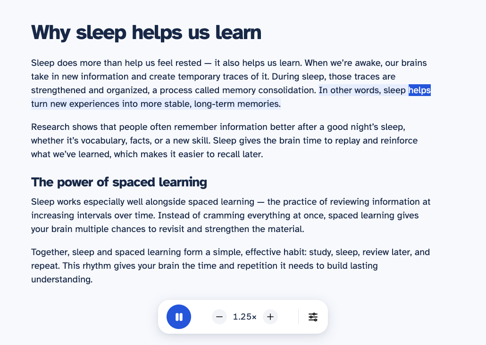

# Read from here

**Click a paragraph. Press play. Keep learning.**

A small Chrome extension that reads the web aloud. One floating toolbar: **play/pause, slower, faster, and settings**. The text being read is highlighted on the page itself.

Use free browser voices, or bring your own OpenAI, ElevenLabs, or Gemini API key. No reader subscription or extension account. Cloud API usage may cost money.

## Get listening

1. [Download the latest release](https://github.com/ottobonilla95/read-from-here/releases/latest) and unzip it into a folder you will keep.
2. Open `chrome://extensions`, enable **Developer mode**, and choose **Load unpacked**.
3. Select the unzipped **Read-from-here** folder containing `manifest.json`. From this repository, select **extension/** instead.
4. Pin **Read from here** in Chrome's extensions menu.
5. Open an article and click the extension icon. Click a paragraph on the page, then press **Play** on the floating toolbar.

Click the extension icon again to close the toolbar and stop listening. Navigating away or closing the source tab also stops playback. [Full installation guide](docs/INSTALL.md).



## Just the controls you need

- **Play and pause** from the toolbar at the bottom of the page.
- **Slower and faster** in steps of 0.25×, from 0.5× to 3×.
- **Click any paragraph** to move your place. Playback continues if playing, and stays paused if paused. Clicking a photo moves to the next caption or passage; it does not read words inside the image.
- **Follow the text on the page.** Browser voices that supply word events highlight the current word and sentence. Cloud voices highlight the current passage; they do not supply word timing in this version.
- **Settings** holds voice, model, API key, voice preview, and automatic scrolling options. It opens in a separate small window, and can close while listening continues.

Links, buttons, forms, and dragging to select text keep their usual behavior. The toolbar uses its own styles so the article's layout stays intact. There is no transcript, reading queue, or side panel.

## Pick a voice

| Provider | What you need |
| --- | --- |
| Browser voices | Nothing extra. Uses your device's available voices. |
| OpenAI | Your OpenAI API key. Try Marin or Cedar. |
| ElevenLabs | Your ElevenLabs API key and a voice from your account. |
| Gemini | Your Gemini API key and one of the preset voices. |

Open **Voice settings**, choose a provider, save your key if needed, and select a voice. Voice previews use your provider quota too. Changing the speed of generated audio reuses that audio. Browser voices restart the current passage when speed changes.

[Provider comparison and sources](PROVIDERS.md). Voice quality and live API access depend on your device and account; this project does not claim one provider is best.

## Your text and keys

There is no extension-operated server. Cloud passages go directly to your selected speech provider.

- Keys stay in extension-only browser session storage by default.
- **Remember on this device** saves a key locally. Saved keys are not encrypted or browser-synced.
- **Remove key** clears that provider's key from both storage locations.
- The page's toolbar never receives your API key. Settings and audio generation run in private extension contexts.
- Article text and up to 12 generated audio passages are held in memory. Uncached passages can incur another API charge.
- Pausing may let an existing request finish, but does not generate the next passage.

Browser voices use the speech engines available on your device. Some require a network connection. Article access comes from clicking the extension icon, rather than permanent access to every website.

## Boundaries

Works with readable HTML in **Chrome 116 or later**. There is no Chrome Web Store listing yet. Other Chromium browsers have not been separately verified.

Chrome internal pages, the Chrome Web Store, built-in PDF viewers, text in images, scanned documents, canvas documents, and cross-origin frames are not supported. Unusual layouts can affect text extraction. AI voices may mispronounce or change wording; check the source when precision matters. Cloud generation can leave a short gap between passages.

## Run or change the code

The runtime is plain JavaScript, HTML, and CSS. Load **extension/** directly; there is no build step.

For development, use Node.js 22 or later:

```sh
npm ci
npm test
npx playwright install chromium
npm run test:browser
npm run package
```

The ZIP is written to `artifacts/Read-from-here.zip`. See [development notes](docs/DEVELOPMENT.md) for architecture and test coverage. Provider responses in integration checks are simulated; they do not establish live provider compatibility or voice quality.

Atkinson Hyperlegible is bundled under the [SIL Open Font License](extension/assets/OFL.txt). The toolbar uses [Tabler Icons](https://github.com/tabler/tabler-icons) under the [MIT license](extension/assets/tabler/LICENSE).
